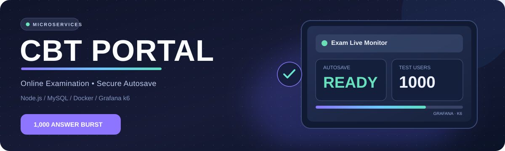
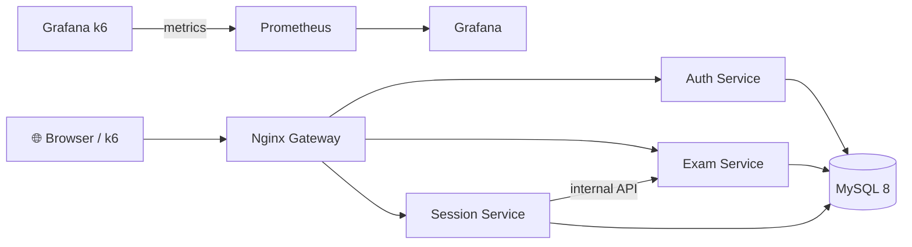

<div align="center">



<br />

[](https://nodejs.org/)
[](https://mysql.com/)
[](https://docs.docker.com/compose/)
[](https://grafana.com/docs/k6/)
[](https://developers.cloudflare.com/tunnel/)

**CBT Portal** · Aplikasi ujian berbasis microservices dengan autosave MySQL, web UI, observability, dan pengujian beban.

[**🖥️ Jalankan Lokal**](#-menjalankan-web-lokal-windows-1011) · [**🌐 Demo HTTPS / GitHub Actions**](#-preview-web-https-melalui-github-actions) · [**📈 Grafana + 1000 Pengiriman**](#-stress-test-1000-pengiriman-jawaban) · [**📚 Docs Teknis**](./cbt-portal/README.md)

</div>

---

## ✨ Built for reliable examinations

| 📖 Modul | ⚡ Fitur |
|:--|:--|
| **Web Exam** | Tampilan ujian HTML/vanilla JavaScript, peserta login memakai NIM |
| **Authentication** | Express session dengan penyimpanan MySQL, bcrypt, cache coalescing untuk login bersamaan |
| **Exam Service** | Soal, metadata ujian, pemeriksaan kunci jawaban internal |
| **Session Service** | Mulai ujian, autosave jawaban idempoten, lihat ulang jawaban, penilaian |
| **Gateway** | Nginx, batas trafik, perutean dinamis antar layanan |
| **Monitoring** | Grafana + Prometheus + k6, metrik response time, failure rate, throughput |
| **Performance QA** | 10 → 100 → 500 → 1000 VU, serta **burst 1000 PUT dengan verifikasi readback** |
| **Web Preview** | GitHub Actions + Cloudflare HTTPS Quick Tunnel dengan one-time PIN email |

## 🧭 Arsitektur



> **Penting:** angka **1.000** adalah *target pengujian*, bukan klaim kapasitas yang sudah terbukti. Keberhasilan harus diperiksa dari HTTP 200, p95/p99, dan jawaban yang benar-benar tersimpan di MySQL.

## 🖥️ Menjalankan web lokal (Windows 10/11)

Persyaratan: **Docker Desktop (WSL2)**, Git, dan PowerShell. Jalankan:

```powershell
git clone https://github.com/Sopayyy02/cc.git
cd cc\cbt-portal
Copy-Item .env.example .env
notepad .env
```

Ganti seluruh nilai `GANTI_...` dengan nilai aman. Untuk mengaktifkan 1.000 peserta dummy dan opsi Grafana, tambahkan:

```dotenv
LOADTEST_STUDENTS=1000
GRAFANA_ADMIN_PASSWORD=GANTI_password_grafana_yang_kuat
```

Kemudian:

```powershell
docker compose up -d --build
docker compose ps
```

| Web | URL |
|:--|:--|
| 🧑‍🎓 **CBT Portal** | **http://localhost:3000** |
| 🩺 Gateway health | http://localhost:3000/healthz |
| 🧪 Demo peserta | NIM **2024001**, password **password123** (hanya data dummy) |

Jika `.env` diubah setelah database dibuat, jalankan `docker compose run --rm db-init` untuk menyemai peserta dummy secara idempoten.

## 🌐 Preview web HTTPS melalui GitHub Actions

Aplikasi lengkap dan database MySQL dijalankan pada **GitHub-hosted runner**, lalu web dipublikasikan melalui **Cloudflare Quick Tunnel**, bukan hanya halaman statis.

[**▶ Buka workflow CBT Web Preview**](https://github.com/Sopayyy02/cc/actions/workflows/cbt-preview-tunnel.yml)

1. Buka tautan workflow, pilih **Run workflow**, lalu tentukan branch `main`.
2. Masukkan **access_email** milik Anda sendiri untuk menerima **Cloudflare one-time PIN**. Jangan menggunakan email orang lain.
3. Isi **live_minutes** (default **350**, maksimum **350** menit); klik **Run workflow**.
4. Buka eksekusi → job **Temporary HTTPS website + keepalive** → lihat URL `https://...trycloudflare.com` pada **Job Summary** atau log **Start Cloudflare email-protected Quick Tunnel**.
5. Buka URL tersebut, verifikasi email dengan PIN, lalu login NIM demo **2024001** / **password123**.
6. Untuk mematikan lebih awal, pilih **Cancel workflow** pada run tersebut.

**Batas sesi:** GitHub-hosted runner hanya diizinkan berjalan **maksimal 6 jam per job**. Workflow menjaga proses tunnel aktif hingga waktu yang Anda tentukan, Anda batalkan, atau runner mencapai batas/platform menghentikan job. URL berubah tiap run dan berhenti ketika proses tunnel dihentikan. Restart membutuhkan run baru—tidak ada cara yang didukung untuk mempertahankan satu runner melewati 6 jam.

**Batas Cloudflare:** Quick Tunnel hanya menerima **200 request in-flight** dan email OTP membutuhkan browser interaktif. Karena itu, URL ini untuk **preview dan functional testing**, bukan load test 1.000 pengiriman serentak. Jangan mengujinya dengan k6 pada angka 1.000: gunakan aplikasi **lokal atau staging privat**. Tidak ada data MySQL produksi yang digunakan pada runner: database dummy dibangun ulang setiap run.

## 📈 Stress test 1.000 pengiriman jawaban

Ada dua cara yang sengaja dipisahkan untuk membantu mendiagnosis kegagalan sekitar 300 pengguna:

| Skenario | Tujuan | Alat |
|:--|:--|:--|
| **Gradual load** | 10 → 100 → 500 → 1.000 VU, bottleneck dan throughput | `loadtest/k6-stress.js` |
| **True answer burst** | 1.000 peserta dummy, 1.000 PUT hampir bersamaan, 1.000 verifikasi GET | `loadtest/k6-burst-1000.js` |
| **Low-memory diagnostic** | 1.000 request PUT concurrent tanpa biaya memori 1.000 VU k6 | `loadtest/node-burst-1000.js` |

### 1. Menyalakan Grafana dan backend test

Pada folder `cbt-portal`, pastikan `.env` sudah berisi `LOADTEST_STUDENTS=1000` dan password Grafana, lalu:

```powershell
docker compose -f docker-compose.yml -f docker-compose.stress.yml -f docker-compose.observability.yml up -d --build --scale auth-service=2 --scale session-service=3 --scale exam-service=1
docker compose -f docker-compose.yml -f docker-compose.stress.yml run --rm db-init
```

| Monitor | URL |
|:--|:--|
| 📊 **Grafana** | http://localhost:3001 |
| 🔬 Prometheus | http://localhost:9090 |
| 🧑‍🎓 CBT Web | http://localhost:3000 |

Login Grafana menggunakan `admin` dan password dari `.env`. Import dashboard Grafana k6 **ID 19665**.

### 2. Jalankan tes ringan-memori lebih dahulu

```powershell
node .\loadtest\node-burst-1000.js
```

Hasil dan sampel error tersimpan di `cbt-portal/loadtest/results/node-burst-summary.json`. Jika skenario Node lulus tetapi k6 1.000 VU gagal, cek **RAM/CPU load generator** dan alokasi Docker Desktop (k6 dapat memerlukan memori beberapa GB untuk 1.000 VU). Jika keduanya gagal, cek HTTP status, log gateway dan MySQL.

### 3. Jalankan k6 + Grafana sebenarnya

Setelah memasang [Grafana k6](https://grafana.com/docs/k6/latest/set-up/install-k6/) pada Windows:

```powershell
powershell -ExecutionPolicy Bypass -File .\scripts\run-grafana-1000.ps1
```

Fase login disebar terlebih dahulu agar burst *autosave* tidak tercampur dengan lonjakan bcrypt login. Pengujian membaca ulang nilai jawaban setelah menerima ACK; sukses bukan sekadar HTTP 200. Ringkasan k6: `loadtest/results/burst-summary.json`.

**Diagnosis 300-an pengguna:**

```powershell
docker stats --no-stream
docker compose logs --tail=200 gateway session-service auth-service mysql
docker compose ps
```

Tafsirkan **429** sebagai rate limit Nginx, **401** sebagai masalah sesi, **500** sebagai kesalahan backend/SQL, dan **502/503/504** sebagai timeout atau upstream yang tidak tersedia. Lihat p95/p99 serta jumlah hasil verifikasi jawaban, bukan VU saja. Jangan mematikan durabilitas MySQL demi mempercantik skor.

Baca [panduan lengkap Grafana + 1000 PUT](./cbt-portal/docs/grafana-1000.md) dan [dokumentasi stress test bertahap](./cbt-portal/docs/stress-test.md).

## 🔐 Keamanan dan batasan

- **Jangan commit** `.env`, token, password, atau data peserta asli.
- Workflow preview memakai **data dummy sekali pakai**, email OTP Cloudflare, dan resource yang dibersihkan saat sesi berakhir.
- Database MySQL tidak diekspos ke port publik.
- Mode `docker-compose.stress.yml` khusus lingkungan uji; jangan pakai di sistem ujian produksi tanpa pengamanan dan pemantauan.
- GitHub-hosted runner memiliki batas durasi, kuota, dan resource; bukan pengganti layanan hosting permanen.

## 📂 Struktur repository

```text
cc/
├── .github/workflows/
│   └── cbt-preview-tunnel.yml    # Web HTTPS sementara, stop/cancel
├── assets/
│   └── cbt-portal-hero.svg       # Header README
├── cbt-portal/
│   ├── public/                   # Web UI peserta
│   ├── src/services/             # Auth, Exam, Session
│   ├── src/shared/               # Database, session, bcrypt coalescing
│   ├── db/                       # Schema, seed data dummy
│   ├── gateway/                  # Nginx reverse proxy
│   ├── monitoring/               # Prometheus + Grafana
│   ├── loadtest/                 # k6 dan Node stress testing
│   ├── scripts/                  # Windows helper dan backup
│   └── docs/                     # Arsitektur, DRP, Grafana
└── README.md
```

---

<div align="center">

**Design for reliability · Measure before you scale.**

<sub>CBT Portal — Microservices • Observability • Verified Autosave</sub>

</div>
